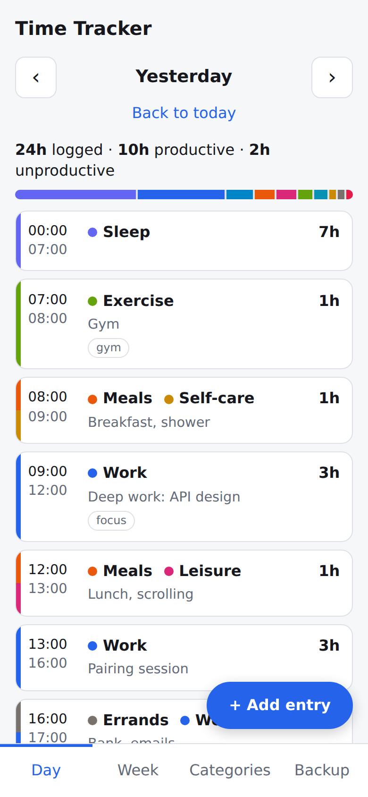
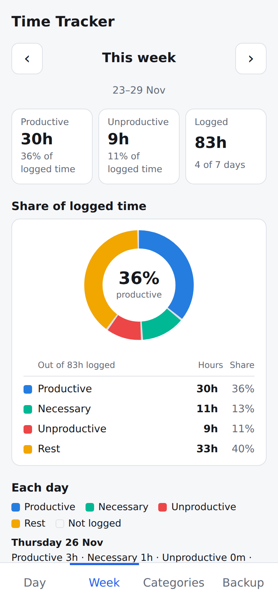
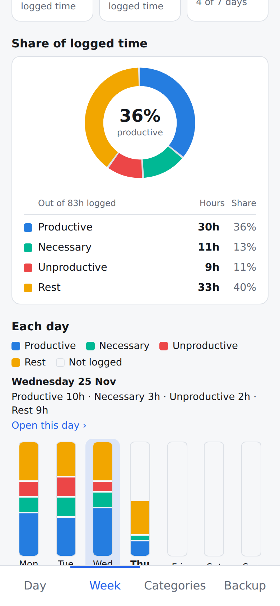
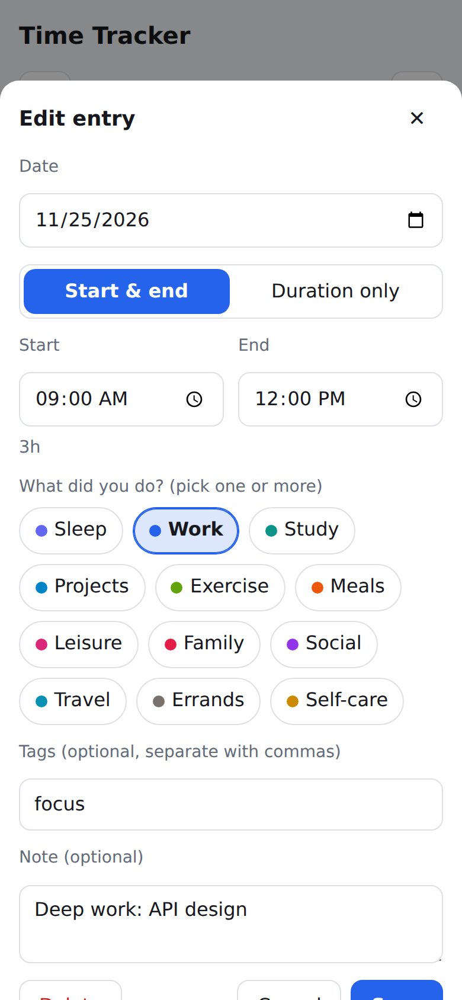
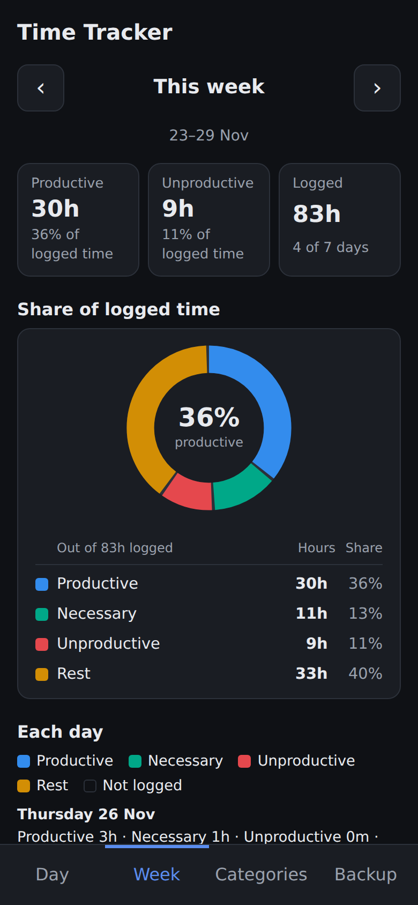

# Time Tracker

See where your day goes. Log what you did in each block of time, and see how many hours were productive, necessary, unproductive or rest.

<p align="center">
  
  
  
</p>
<p align="center">
  
  
</p>
<p align="center"><sub>Screenshots use made-up demo data.</sub></p>

## Features

- Log time with a start and end (or just a duration), one or more categories, tags and a note
- An hour can hold several activities: "prayer + project" counts as a productive hour
- Day view with totals, and a week view with charts and a table
- Your own categories, each counting as productive, necessary, unproductive or rest
- Export a backup file and import it again, on this or another device
- Works on phone and desktop, installs to your home screen and works offline

## Privacy first

Your data never leaves your device. There is no backend, no database, no account and no tracking. Entries are stored in your own browser (IndexedDB).

Because of that, **clearing your browser data deletes your entries**, and your phone and computer don't share data. Use **Backup → Download backup** regularly, and import the file to move data between devices.

## Run locally

Requires Node.js 22.12 or newer.

```bash
npm install
npm run dev
```

Then open the address it prints, ending in `/time-tracker/`.

## Live link

https://hassan19farah.github.io/time-tracker/

On your phone, open it in Chrome and choose **⋮ → Install app** (Safari: **Share → Add to Home Screen**).
